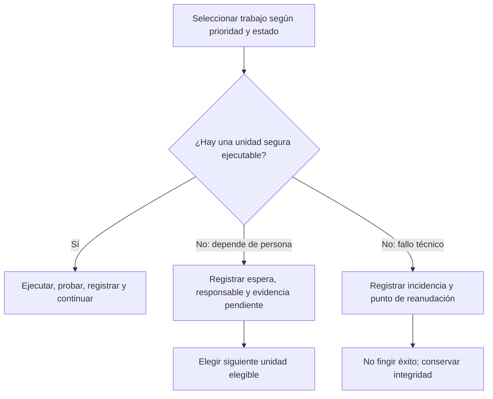

# Actualización 13/11/2026 — Ecosistemas de trabajo con IA · v1.1

**Fecha:** 13 de noviembre de 2026 · **Tipo:** mejora metodológica para adopción voluntaria.

Esta guía pública recoge aprendizajes de diseño y pruebas en un ecosistema de trabajo con asistente, GitHub y una bandeja de revisión. **No instala automatizaciones, no concede permisos, no es una instrucción institucional oficial ni demuestra que una conexión particular ya funcione.** Cada persona debe revisar su propio contexto y probar su configuración.

## Resumen de los cambios

| Criterio anterior o riesgo | Criterio recomendado desde esta versión | Cómo comprobarlo |
|---|---|---|
| Pedir a la persona prefijos como «IA:» o pasos duplicados | **Comentarios normales y/o casillas de checklist como señales independientes**, sin comando obligatorio, cuando la integración se haya configurado | Una acción real del titular se recibe, interpreta, registra y no se duplica |
| Confundir una casilla marcada con una orden | La casilla registra **el hecho que describe**; el comentario puede ser información, corrección, decisión o encargo | Verificar autor, texto, competencia y tipo de actuación |
| Detener toda la cola por una autorización pendiente | **Poner en espera solo el expediente afectado**, conservar responsable, evidencia y próximo control, y continuar con otra unidad elegible | Dos tareas: una esperando validación, la otra produce un resultado y RUN |
| Retener un bloqueo de escritura mientras se espera respuesta | El `run_lock` protege solo una **transacción corta de escritura**, no decisiones ni conversaciones | Leer estado antes y después; lock propio liberado y próximo turno intacto |
| «Reparar» bloqueos por antigüedad sin examen | Investigar dueño, RUN, commits, actividad y riesgos; recuperar excepcionalmente solo con facultad y trazabilidad | No hay dos escritores activos ni sobrescritura accidental; la recuperación queda documentada |
| Interpretar comentarios repetidos como nuevas órdenes | Registrar ID de acción, tarjeta y casilla, autor y cursor; aplicar idempotencia | Releer el mismo evento sin duplicar tareas ni ejecutar dos veces |
| Declarar completado un flujo solo por cambiar el prompt | Separar **documentado → configurado → probado → operativo verificado** | Prueba real extremo a extremo y segunda ejecución sin duplicados |

## 1. Una bandeja humana simple y opcional

Si tu equipo utiliza Trello, GitHub Issues u otra herramienta de seguimiento, configura una **bandeja humana** donde puedas:

- **Comentar en lenguaje natural**: «Revisé el documento. Corrige el resumen y prepara otra versión». No debe exigirse un prefijo especial para comprenderlo.
- **Marcar o desmarcar una casilla**: acredita esa revisión o actualiza el estado de esa acción. **No hay obligación de comentar además**.
- **Revisar una entrega**: la IA puede preparar el siguiente borrador si está permitido; una firma, envío oficial, declaración, compra, aprobación administrativa o publicación sigue sujeto a la persona competente.

**Importante:** ninguna herramienta lee comentarios de otra por arte de magia. Debe existir una integración accesible y autorizada, una instrucción de captura y un mecanismo real para registrar y procesar eventos. Si no hay conexión, el asistente debe indicarlo, no simular recepción.

El sistema debe distinguir entre **autor de una orden**, comentario de otra persona, notificación automática y comentario propio del agente. El texto de terceros puede servir como evidencia, pero no se convierte sin más en una autorización.

### Ejemplos ficticios

| Acción en la tarjeta | Resultado permitido de la IA |
|---|---|
| «Revisé el informe; mejora los gráficos» | Preparar versión revisada y dejarla disponible |
| Marcar «Verifiqué la fecha del evento» | Registrar la comprobación y evaluar siguiente preparación |
| «Aprobado para enviarlo a toda la comunidad» | Registrar la decisión expresada, **sin enviar ni publicar automáticamente** si hace falta una habilitación específica |
| Desmarcar «Validé la nómina» | Marcar el estado actual como pendiente, conservar la historia y no dar por válida la nómina |
| Comentario de otra persona: «Ya está enviado» | Tratarlo como antecedente; verificar envío en la fuente oficial |

## 2. Dos colas, una continuidad

**Cola de trabajo automatizable:** tareas seguras, autorizadas, con fuentes suficientes y un resultado verificable.

**Agenda humana o seguimiento:** decisiones, firmas, validaciones, respuestas de terceros y pruebas que faltan, con responsable, plazo de la naturaleza correcta y disparador de reanudación.

Cuando un expediente necesita a una persona, **no bloquear toda la automatización**. Registra la espera y selecciona otra unidad que pueda avanzar, manteniendo prioridades y fechas oficiales. No interpretes «esperando» como «terminado».



## 3. Bloqueos técnicos y recuperación prudente

- Antes de escribir en un registro compartido, leer estado y versión (SHA o control equivalente); adquirir un **bloqueo de escritura propio** solo durante la transacción autorizada.
- Guardar producto, cambios, pruebas y RUN; comprobar el propietario; liberar **solo el bloqueo propio**; releer que quedó desactivado.
- Ante error o interrupción, no declarar éxito. Mantener un RUN o checkpoint de reanudación y evitar repetir acciones externas sin idempotencia.
- Un bloqueo ajeno antiguo **no prueba abandono**. Su antigüedad solo desencadena investigación. Una recuperación requiere verificar que no haya otro escritor activo y, si aplica, aprobación competente y registro del procedimiento; un SHA aislado no basta para garantizar exclusión mutua.
- Una aprobación humana pendiente **no es una razón para conservar el bloqueo técnico**. Si una tarea debe esperar, terminar la transacción y seguir con otras.

No todos los proyectos pequeños necesitan un lock global: elige la estrategia que corresponda a la cantidad de escritores y riesgos reales.

## 4. Prueba mínima antes de decir «funciona»

1. **Lectura:** registra un comentario normal o marca una casilla con un usuario autorizado.
2. **Captura:** acredita ID del evento, autor, hora y tarjeta/tarea; evita recoger datos privados innecesarios.
3. **Decisión:** clasifica qué puede hacer la IA y qué necesita revisión o aprobación.
4. **Ejecución segura:** produce un cambio permitido, enlázalo al registro existente y crea RUN.
5. **Relectura:** prueba que el producto y estado se guardaron; comprueba el desbloqueo.
6. **Idempotencia:** repite la captura sin cambio humano y verifica que no generó un segundo trabajo.

Si no hay evidencias de los seis pasos, informa el estado exacto: **guía publicada, integración configurada, prueba parcial o funcionamiento completo**. No fuerces una prueba con acciones sensibles.

## 5. Cómo adaptar estas reglas a tu propio sistema

Esta actualización es **un patrón opcional**, no una migración automática. Puede aplicarse con GitHub Issues, un tablero, una hoja de cálculo o incluso una lista simple. Lee primero tu estructura actual, aprovecha lo existente y añade solo lo necesario.

### Mensaje listo para usar con tu ChatGPT

Copia este texto en una conversación del asistente que uses con **tu propio repositorio**:

```text
Quiero revisar y, si corresponde, actualizar los criterios de mi propio ecosistema de trabajo según la actualización pública del 13/11/2026:
https://github.com/germaquintana/ecosistemas-gpt-github/blob/main/ACTUALIZACION_2026-11-13.md

Lee la guía vigente y después revisa mi repositorio, mis instrucciones, estado, tareas y automatizaciones disponibles. No des por conectado algo que no puedas comprobar.

Primero identifica conflictos, riesgos, mecanismos duplicados y cambios necesarios. Conserva una fuente de verdad por dominio y el historial de decisiones. Propón una actualización mínima que permita:
- usar comentarios normales y cambios de casillas como señales independientes, si tengo esa integración;
- dejar esperando solo la tarea que requiere decisión humana, mientras avanzan otras tareas elegibles;
- usar bloqueos técnicos breves, recuperación prudente e idempotencia por IDs de evento;
- separar acciones documentales permitidas de firmas, envíos, declaraciones, publicaciones y otras decisiones reservadas;
- registrar RUN, pruebas y el siguiente paso, sin declarar funcionando lo que no se ha probado.

No me exijas un prefijo como IA: ni dos mecanismos obligatorios para la misma señal. Reutiliza las tareas y tarjetas existentes. Antes de escribir o alterar automatizaciones, comprueba que autorizo el destino, el alcance y los permisos necesarios; realiza solo cambios autorizados. No publiques datos ni expedientes privados. Usa ejemplos ficticios y registra versiones, pruebas, problemas y cómo revertir. Si existe otro escritor activo o un lock que no posees, no lo liberes por antigüedad; deja constancia y trabaja solo en ámbitos independientes seguros.

Entrega enlaces reales y un resumen diferenciando: diseño, configuración realizada, prueba real y pendientes.
```

**No copies las estructuras ni los nombres del proyecto de otra persona.** Adapta el texto al nivel de acceso, las reglas y el riesgo de tu propia organización.

## 6. Alcance y límites de la actualización

- Estos son **criterios recomendados**, no nuevas capacidades garantizadas de ChatGPT, GitHub o Trello.
- La prueba de una integración requiere verificar eventos reales y escrituras en el proyecto del colega; una instrucción guardada no basta.
- Un repositorio público es solo un material de aprendizaje: no autoriza acceder a repositorios privados, cuentas de terceros ni datos institucionales.
- Esta versión se publica para **lectura y aprendizaje**, sin cambiar la situación de licenciamiento existente. Consulta [LICENCIAMIENTO.md](LICENCIAMIENTO.md).

**Referencia de instalación desde cero:** [IMPLEMENTAR_CON_CHATGPT.md](IMPLEMENTAR_CON_CHATGPT.md).  
**Configuraciones generales:** [CONFIGURACIONES_Y_COMPROMISOS.md](CONFIGURACIONES_Y_COMPROMISOS.md).  
**Autonomía y pruebas:** [docs/05-autonomia-segura.md](docs/05-autonomia-segura.md).
