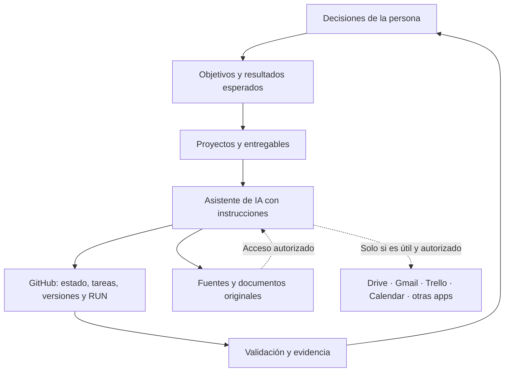

# Comenzar aquí — entiende lo que adoptarías en cinco minutos

Esta biblioteca **no es un software que se instala**. Es una metodología de trabajo con plantillas y decisiones configurables. Puedes adoptar una parte y descartar el resto.

## 1. Mapa del ecosistema

## 2. Los siete compromisos de buenas prácticas

| Nº | Si adoptas esta práctica... | Te comprometes a... |
|---|---|---|
| 1 | **Definir antes de ejecutar** | Expresar objetivo, resultado, responsable, plazo real y criterio de término |
| 2 | **Conservar fuentes confiables** | No sustituir originales con resúmenes; citar dónde está cada evidencia |
| 3 | **Versionar decisiones** | Mantener instrucciones, estado, cambios y próxima acción en GitHub |
| 4 | **Evitar duplicaciones** | Una tarea por resultado; consultar antes de crear otra |
| 5 | **Respetar privacidad** | No entregar datos, permisos o credenciales que no te pertenezcan |
| 6 | **Delimitar autonomía** | Reservar para revisión humana las acciones sensibles o irreversibles |
| 7 | **Comprobar entregas** | No declarar éxito sin resultado, prueba y evidencia verificables |

Son **compromisos voluntarios de trabajo**, no una relación contractual con el autor del repositorio.

## 3. Qué se configura y qué no

- **Base recomendada:** un proyecto propio (preferentemente privado), README, objetivo, `AGENTS.md` ajustado, tareas/issues y estado breve.
- **Según necesidad:** Google Drive u otro espacio documental, plantillas, métricas, CI, pruebas, bitácoras.
- **Solo con autorización:** conectores a correo, calendarios, datos institucionales, automatizaciones, escrituras externas y publicación.
- **Nunca de forma automática por abrir el enlace:** ninguna aplicación obtiene acceso; no se crean tareas, correos ni calendarios; no se instalan extensiones.

## 4. Tu primera práctica

Elige un proyecto pequeño, como organizar materiales de una actividad. Define un entregable que puedas revisar, crea un repositorio privado, conserva allí las instrucciones y el estado, y realiza una sola tarea. Después comprueba y documenta el resultado.

## 5. Pide una explicación adaptada a ti

Abre [PROMPT_PARA_CHATGPT.md](PROMPT_PARA_CHATGPT.md). Copia el texto y pégalo en ChatGPT junto a la URL de esta biblioteca. Recibirás un mapa, tabla de prácticas y configuración de inicio. **La IA deberá leer el repositorio en vivo** y declarar cualquier archivo inaccesible, en vez de inventar contenidos.

Puedes consultar [un ejemplo de cómo debería verse la respuesta](EJEMPLO_RESPUESTA_ESQUEMATICA.md).
