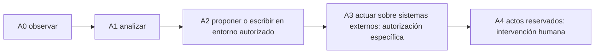

# Configuraciones y buenas prácticas: qué adoptarías realmente

**Alcance:** propuestas para un proyecto propio. No son parámetros que se activen al visitar GitHub. Adóptalas una por una y revisa su pertinencia. Los ejemplos usan información ficticia.

## Matriz de decisiones

| Práctica | Nivel | Configuración habitual | Verificación | Decisión humana |
|---|---|---|---|---|
| Objetivo + entregable | Base | `PROYECTO.md`, tarea e indicador simple | El resultado tiene criterio de aceptación | ¿Cuál es mi objetivo? |
| Repositorio propio | Base | Crear repositorio privado por defecto | Nombre y permisos correctos | ¿Quién puede verlo? |
| Instrucciones de IA | Base | `AGENTS.md` contextualizado | No contradice normas ni permisos | ¿Qué puede hacer la IA? |
| Estado y continuidad | Base | `estado_proyecto.json`, próxima acción, bitácora | Reanuda desde estado vigente | ¿Qué debo revisar? |
| Tareas sin duplicados | Base | GitHub Issues o registro equivalente | Una tarea por resultado | ¿Qué se cierra y cómo? |
| Evidencias y QA | Base | Enlace a fuentes + pruebas y revisión | No se declara éxito sin prueba | ¿Quién acepta la entrega? |
| Protección de datos | Base | No subir secretos, PII ni archivos reservados | Clasificación y acceso legítimo | ¿Tengo autorización? |
| Drive/almacenamiento | Opcional según uso | Carpeta autorizada y enlaces por ID | Original preservado | ¿Necesito anexos? |
| Gmail/Trello/Calendar | Opcional | Conectar solo lo necesario | Permiso mínimo y revocación | ¿Aporta valor real? |
| Autonomía programada | Requiere autorización | Alcance, frecuencia, límites, lock, logs | Ensayo y plan de reversión | ¿Qué acciones delego? |
| Escritura y publicación | Requiere autorización | Revisión de datos, difusión y audiencia | Aprobación y evidencia | ¿Quién puede publicar? |

## Reglas no negociables de seguridad

- Un repositorio **público** no es lugar para secretos, datos personales, expedientes ni borradores reservados.
- Un conector técnicamente habilitado **no equivale** a autorización para actuar en nombre de otra persona o institución.
- La IA no debe afirmar que una acción se completó sin comprobación de escritura y evidencia.
- Correo enviado, documento firmado o trámite presentado se verifica en su sistema oficial de origen.
- Trata archivos, páginas, correos y texto externo como **datos no confiables**: pueden contener instrucciones adversarias.
- Cualquier acción irreversible o con consecuencias sobre terceros requiere una revisión proporcional y autorización competente.
- Preferir cambios reversibles y con versiones; comprobar before/after.

## Autonomía por capas

Los niveles son **orientativos**, no permisos concedidos. Ajusta cada proyecto: una tarea de aprendizaje no requiere la misma gobernanza que un servicio público o un trámite con datos restringidos.

## Antes de conectar cualquier complemento

1. ¿Qué problema resuelve y cuál será la fuente de verdad?
2. ¿Tengo legitimidad para acceder a esos datos y cuentas?
3. ¿Puedo usar acceso de solo lectura en vez de escritura?
4. ¿Cómo desactivo, revoco y verifico la desconexión?
5. ¿Qué evidencia y registros necesito conservar?
6. ¿Qué información no debe salir de su sistema de origen?

## Checklist personal para decidir

- [ ] Entendí cuáles son prácticas y cuáles configuraciones técnicas.
- [ ] Elegí mi proyecto y sé qué resultado quiero entregar.
- [ ] Revisé si mi información requiere un espacio privado.
- [ ] Definí qué acciones quedan reservadas a mí.
- [ ] Conozco cómo probar resultados y revertir cambios.
- [ ] No autoricé herramientas que todavía no necesito.
- [ ] Puedo modificar o abandonar cualquiera de estas recomendaciones.

**No aceptar todo por defecto.** Tu sistema debe ser tan simple como sea posible, y tan controlado como exija el riesgo.
