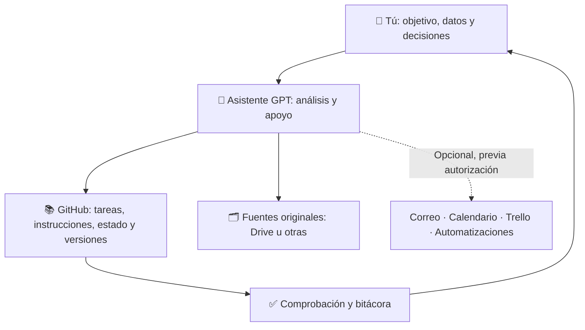

# Ejemplo de respuesta esquemática para quien recibe el enlace

> Modelo orientador. Los detalles y las configuraciones deben comprobarse en los archivos vigentes del repositorio. **No es evidencia de que una herramienta esté conectada.**

## ¿Qué sistema estás evaluando?

## Resumen de buenas prácticas

| Principio | Qué harías tú | Por qué importa |
|---|---|---|
| 1. Objetivo antes de actividad | Escribir un resultado concreto y verificable | Evitas producir archivos sin utilidad |
| 2. Una fuente por cada hecho | Mantener original y referencia | Evitas versiones incompatibles |
| 3. Estado recuperable | Guardar la próxima acción y los cambios | Continúas entre conversaciones |
| 4. Tareas sin duplicidad | Reconciliar antes de abrir otra issue | Conservas foco |
| 5. Privacidad | Mantener datos no públicos en origen autorizado | Proteges a las personas |
| 6. Autonomía limitada | Definir qué puede leer/escribir la IA | Conservas control |
| 7. Comprobación | Pedir prueba de resultado y aprobación humana | Evitas cierres ficticios |

## Qué prácticas podrías adoptar

**Base recomendada:** objetivo del proyecto, repositorio privado, README, instrucciones del asistente, tareas, estado actual, próxima acción, revisión de datos y evidencias.

**Complementos opcionales:** Drive u otro almacenamiento, Gmail, Trello, Calendar, validadores, dashboards y automatizaciones.

**Requieren decisión y autorización específicas:** conexión de cuentas, acceso a datos restringidos, escritura en sistemas externos, ejecución programada, envíos, publicaciones y acciones irreversibles.

## Plan de inicio en cinco pasos

1. Escoge **un resultado pequeño** (ejemplo ficticio: organizar materiales de una actividad).
2. Crea un repositorio privado, con acceso limitado al equipo que corresponde.
3. Adapta `plantilla-proyecto/`: objetivos, roles, limitaciones y siguiente acción.
4. Realiza una tarea y verifica el producto.
5. Registra lo realizado y decide **solo entonces** si agregas otra herramienta.

## Lo que NO has autorizado al leer esta guía

No has dado acceso a GitHub, Gmail, Drive, calendarios, cuentas ni archivos personales; no has instalado un agente; no has aceptado que se envíen correos o publiquen documentos.

## Lista de decisión

- [ ] Entiendo las siete prácticas.
- [ ] Elegí mis herramientas base.
- [ ] Identifiqué los datos que no debo publicar.
- [ ] Definí mi límite de autonomía.
- [ ] Sé qué comprobar antes de declarar una entrega.
- [ ] Entiendo que puedo posponer los complementos.

**Pregunta final útil:** ¿Qué tipo de proyecto quieres gestionar y qué herramientas usas actualmente? Una vez respondas, se puede adaptar el modelo sin automatizar nada todavía.
