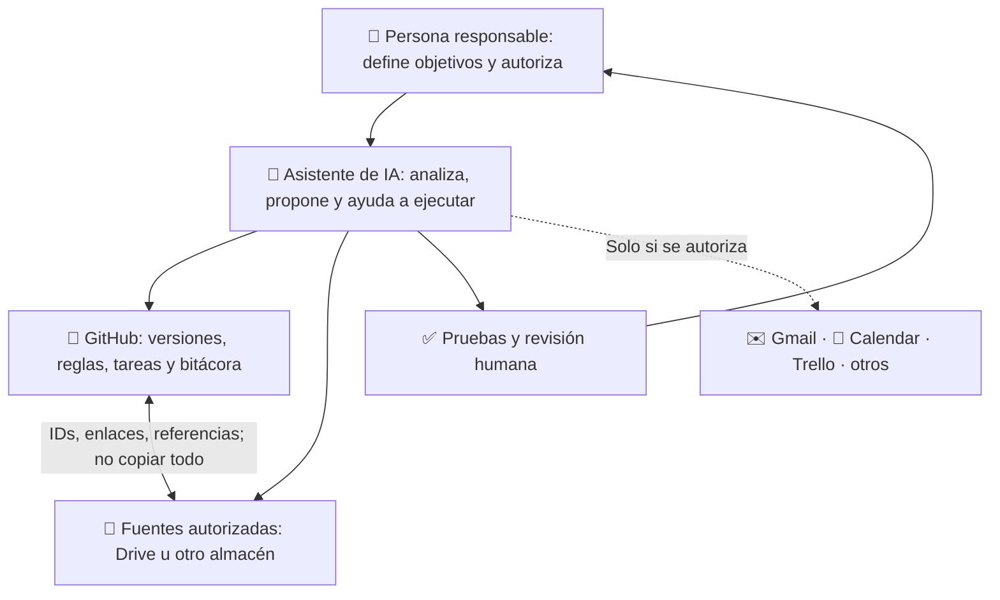

# Ecosistemas GPT + GitHub · Guía abierta para colegas

**Aprende a organizar proyectos con un asistente de IA, GitHub y herramientas complementarias, de forma segura, verificable y adaptable.**

> Guía educativa de adopción voluntaria, versión 1.0 (11-11-2026). **Leer esta página no instala nada, no conecta cuentas ni concede permisos.** No es una política oficial de una institución, de OpenAI ni de GitHub.

## ¿Te compartieron este repositorio? Comienza aquí

**[1. Entiende el sistema en 5 minutos](COMENZAR_AQUI.md)** · **[2. Consulta las prácticas y configuraciones](CONFIGURACIONES_Y_COMPROMISOS.md)** · **[3. Pide a ChatGPT un resumen esquemático y personalizado](PROMPT_PARA_CHATGPT.md)**

### Arquitectura en una mirada

### Qué prácticas propone adoptar

| Tema | Regla recomendada | Por qué |
|---|---|---|
| Dirección | Un objetivo claro y un entregable verificable | Evita tareas sin propósito |
| Fuente de verdad | Una autoridad por tipo de dato | Evita contradicciones |
| Continuidad | Estado, próxima acción y RUN versionados | Permite retomar sin empezar de cero |
| Seguridad | Mínimos permisos y fuentes autorizadas | Reduce riesgos |
| Autonomía | La IA actúa dentro de límites, con validaciones | Impide ejecuciones no deseadas |
| Calidad | Comprobar antes de declarar completado | Mejora fiabilidad |
| Modularidad | Complementos opcionales; conectar y desconectar | Reduce complejidad |

**No estás suscribiendo un servicio ni aceptando automáticamente ninguna configuración.** Adoptar una práctica exige decidirla y configurarla deliberadamente en *tu propio* proyecto.

## Ruta de aprendizaje

- [Guía rápida y explicaciones](COMENZAR_AQUI.md)
- [Prácticas, controles y niveles de adopción](CONFIGURACIONES_Y_COMPROMISOS.md)
- [Prompt listo para copiar en ChatGPT](PROMPT_PARA_CHATGPT.md)
- [Ejemplo esquemático de la respuesta que deberías recibir](EJEMPLO_RESPUESTA_ESQUEMATICA.md)
- [Tu primer proyecto](docs/01-primer-proyecto.md)
- [Arquitectura y autoridad de fuentes](docs/02-arquitectura.md)
- [Seguridad y privacidad](docs/03-seguridad-privacidad.md)
- [Gestión de objetivos y tareas](docs/04-gestion-proyectos.md)
- [Autonomía responsable](docs/05-autonomia-segura.md)
- [Integraciones modulares](docs/06-modularidad.md)
- [Plantilla para crear tu propio repositorio](plantilla-proyecto/README.md)

**Importante:** emplea repositorios privados para trabajo con información no destinada a publicación. Nunca copies credenciales, expedientes o datos personales a esta biblioteca pública. Usa ejemplos ficticios.

## Uso y mantenimiento

Este material se puede leer y compartir mediante enlaces. La licencia de reutilización aún requiere una decisión explícita del titular; mientras tanto, no presupongas una licencia abierta para redistribuir o adaptar los archivos. Consulta [licenciamiento](LICENCIAMIENTO.md) y [seguridad](SECURITY.md). Las mejoras se pueden proponer en las *Issues* públicas sin adjuntar información reservada.
