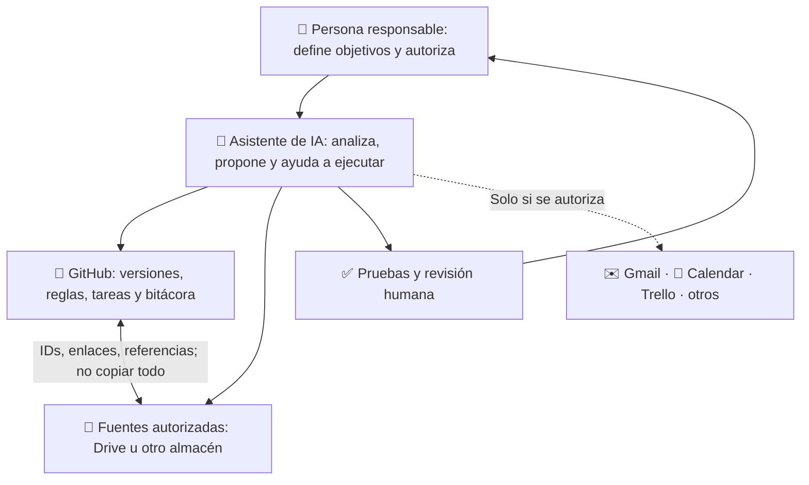

# Ecosistemas GPT + GitHub · Guía abierta para colegas

**Aprende a organizar proyectos con un asistente de IA, GitHub y herramientas complementarias, de forma segura, verificable y adaptable.**

> Guía educativa de adopción voluntaria, versión 1.2 (actualización 13-11-2026). **Leer esta página no instala nada, no conecta cuentas ni concede permisos.** No es una política oficial de una institución, de OpenAI ni de GitHub.

## Nueva versión 1.2 — 13/11/2026: mejora permanente

El repositorio dispone ahora de una [guía de mejora continua semanal](docs/MEJORA_CONTINUA_SEMANAL.md) y un [manifiesto de versión](VERSION.json). Los colegas pueden **consultar semanalmente novedades y compararlas con la versión que realmente adoptaron**, sin reconstruir su proyecto ni aplicar cambios automáticamente.

- **Repositorio de referencia:** [novedades de la v1.2](ACTUALIZACION_2026-11-13_MEJORA_CONTINUA.md) y [historial](CHANGELOG.md).
- **Revisión semanal del origen:** control editorial estructural de GitHub Actions, programado para los lunes 09:17 hora de Santiago; su ejecución real debe comprobarse en [Actions](https://github.com/germaquintana/ecosistemas-gpt-github/actions).
- **Para colegas que ya tienen proyecto:** [instalación optativa de la revisión semanal](plantilla-proyecto/REVISION_SEMANAL_GUIA.md). La verificación automática no modifica su sistema sin aprobación.

**No hace falta configurar nada para seguir usando esta biblioteca manualmente.** Una nueva versión pública no concede permisos ni sustituye pruebas del sistema propio.

## Novedades del 13/11/2026 — versión 1.1

La [actualización metodológica del 13 de noviembre](ACTUALIZACION_2026-11-13.md) recoge criterios para trabajar **con menos pasos y más continuidad**:

- **Comentarios normales o casillas de checklist** como señales humanas independientes, cuando se haya configurado y probado una integración. No exigir comandos como `IA:` ni una doble confirmación para cada revisión.
- **Esperas humanas no bloqueantes:** conservar pendientes de firma, aprobación o respuesta en la tarea correspondiente; seguir con otra tarea automática elegible.
- **Bloqueos técnicos breves y recuperación prudente:** distinguir el estado de una tarea del bloqueo temporal de escritura; nunca liberar un lock ajeno solo por su antigüedad.
- **Idempotencia y evidencia:** registrar eventos por ID, comprobar lo escrito y diferenciar configuración de funcionamiento real.

**¿Ya tienes un ecosistema?** Abre esa actualización y copia el mensaje «Cómo adaptar estas reglas a tu propio sistema». No necesitas empezar desde cero ni copiar configuraciones del autor.

## Implementar tu propio ecosistema directamente desde ChatGPT

**¿Quieres que ChatGPT te ayude a construir el sistema en TU cuenta de GitHub, en vez de solo explicarlo?** Usa la [guía de implementación paso a paso](IMPLEMENTAR_CON_CHATGPT.md). Contiene un mensaje único para copiar al chat, un diagnóstico mínimo, los archivos del proyecto, pruebas de verificación y un modelo seguro para conectar complementos opcionales.

> Abrir GitHub no instala ni ejecuta nada. El colega debe **pegar un mensaje de instrucción en su ChatGPT** y autorizar el acceso y las escrituras en su propio entorno. No se utilizan las cuentas del autor de esta guía.

**Enlace directo para enviar a un colega:** [IMPLEMENTAR_CON_CHATGPT.md](IMPLEMENTAR_CON_CHATGPT.md)

## ¿Te compartieron este repositorio? Comienza aquí

**[1. Entiende el sistema en 5 minutos](COMENZAR_AQUI.md)** · **[2. Consulta las prácticas y configuraciones](CONFIGURACIONES_Y_COMPROMISOS.md)** · **[3. Pide a ChatGPT un resumen esquemático y personalizado](PROMPT_PARA_CHATGPT.md)**

### ¿Quieres compartir esto con otra persona?

Envía el enlace [**Mensaje para compartir**](MENSAJE_PARA_COMPARTIR.md), o directamente el URL de este repositorio. Para obtener una **respuesta esquemática en ChatGPT** —arquitectura, prácticas, configuraciones recomendadas, componentes opcionales, riesgos y pasos de adopción— tu colega debe abrir [**PROMPT_PARA_CHATGPT.md**](PROMPT_PARA_CHATGPT.md), copiar el texto y pegarlo en su propia conversación de ChatGPT. El enlace por sí solo no ejecuta un asistente ni instala prácticas.

### Arquitectura en una mirada

### Qué prácticas propone adoptar

| Tema | Regla recomendada | Por qué |
|---|---|---|
| Dirección | Un objetivo claro y un entregable verificable | Evita tareas sin propósito |
| Fuente de verdad | Una autoridad por tipo de dato | Evita contradicciones |
| Continuidad | Estado, próxima acción y RUN versionados | Permite retomar sin empezar de cero |
| Seguridad | Mínimos permisos y fuentes autorizadas | Reduce riesgos |
| Autonomía | La IA actúa dentro de límites, con validaciones | Impide ejecuciones no deseadas |
| Calidad | Comprobar antes de declarar completado | Mejora fiabilidad |
| Modularidad | Complementos opcionales; conectar y desconectar | Reduce complejidad |

**No estás suscribiendo un servicio ni aceptando automáticamente ninguna configuración.**

**Versión y novedades:** [Historial](CHANGELOG.md) · [Mejora continua semanal v1.2](ACTUALIZACION_2026-11-13_MEJORA_CONTINUA.md) · [Criterios v1.1](ACTUALIZACION_2026-11-13.md). Adoptar una práctica exige decidirla y configurarla deliberadamente en *tu propio* proyecto.

## Ruta de aprendizaje

- [Guía rápida y explicaciones](COMENZAR_AQUI.md)
- [Prácticas, controles y niveles de adopción](CONFIGURACIONES_Y_COMPROMISOS.md)
- [Prompt listo para copiar en ChatGPT](PROMPT_PARA_CHATGPT.md)
- [Ejemplo esquemático de la respuesta que deberías recibir](EJEMPLO_RESPUESTA_ESQUEMATICA.md)
- [Tu primer proyecto](docs/01-primer-proyecto.md)
- [Arquitectura y autoridad de fuentes](docs/02-arquitectura.md)
- [Seguridad y privacidad](docs/03-seguridad-privacidad.md)
- [Gestión de objetivos y tareas](docs/04-gestion-proyectos.md)
- [Autonomía responsable](docs/05-autonomia-segura.md)
- [Integraciones modulares](docs/06-modularidad.md)
- [Plantilla para crear tu propio repositorio](plantilla-proyecto/README.md)

**Importante:** emplea repositorios privados para trabajo con información no destinada a publicación. Nunca copies credenciales, expedientes o datos personales a esta biblioteca pública. Usa ejemplos ficticios.

## Uso y mantenimiento

Este material se puede leer y compartir mediante enlaces. La licencia de reutilización aún requiere una decisión explícita del titular; mientras tanto, no presupongas una licencia abierta para redistribuir o adaptar los archivos. Consulta [licenciamiento](LICENCIAMIENTO.md) y [seguridad](SECURITY.md). Las mejoras se pueden proponer en las *Issues* públicas sin adjuntar información reservada.
