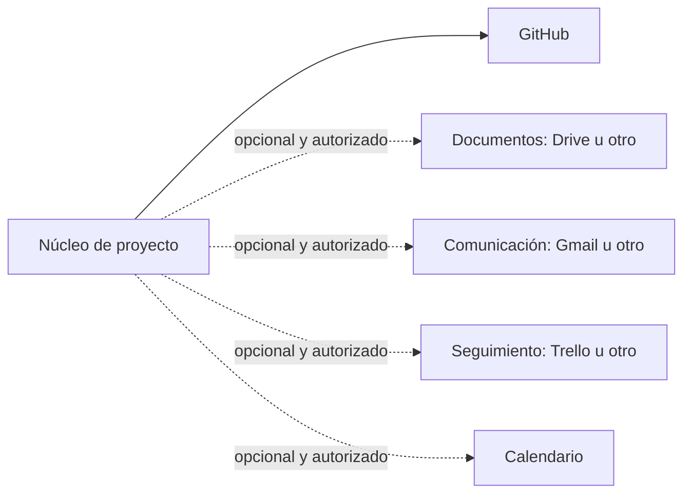

# 06 · Complementos modulares: sumar y desconectar

Un ecosistema sano funciona con un núcleo pequeño. Las herramientas adicionales son **módulos**, no condiciones obligatorias de participación.

## Ciclo de vida
1. **Catalogar**: ¿qué propósito tiene el módulo?
2. **Evaluar**: ¿a quién pertenecen los datos y qué permisos hacen falta?
3. **Conectar en lectura** cuando sea suficiente y expresamente permitido.
4. **Autorizar escrituras por separado**, con límites y pruebas.
5. **Vigilar** si aporta valor real.
6. **Pausar o desconectar**: comprobar dependencias, conservar evidencias, revocar accesos autorizados y verificar el resultado.

No elimines proyectos o documentos al desconectar un módulo. No consideres una integración como activa sin verificarla. Las configuraciones se registran por módulo; consultar un archivo público nunca conecta cuentas.

Consulta [configuraciones y compromisos](../CONFIGURACIONES_Y_COMPROMISOS.md).
